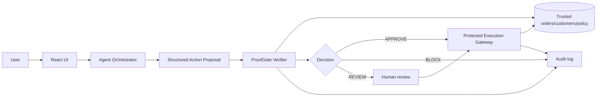
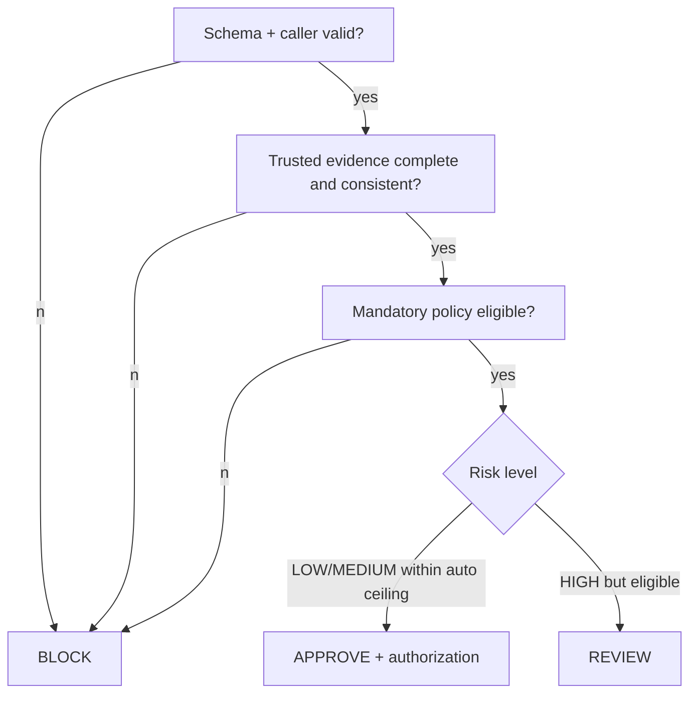

# Architecture

## Context and boundaries

ProofGate is an independent enforcement point, not an LLM safety prompt. The agent may propose `refund.create`; only the protected gateway can mutate an order/refund record. Trusted sources are the backend's order/customer store and versioned policy store. Agent input, browser input, and candidate evidence IDs are untrusted.



## Components

| Component | Responsibility | Cannot do |
|---|---|---|
| UI | request, display status/evidence, submit review decision | execute protected tool |
| Agent adapter | turn request into schema-valid proposal | authorize or execute refund |
| Verifier | retrieve evidence, evaluate EAC/policy/risk, mint authorization | trust agent evidence |
| Gateway | consume authorization once and atomically apply approved action | verify arbitrary agent calls |
| Review service | record authorized reviewer decision | waive mandatory policy blocks |
| Audit store | append decision/evidence/execution events | act as trusted source of business state |

## Verification sequence

```mermaid
sequenceDiagram
 participant U as User/UI
 participant A as Agent
 participant V as Verifier
 participant S as Trusted stores
 participant G as Gateway
 U->>A: support request
 A->>V: action proposal
 V->>V: validate EAC and caller context
 V->>S: independently read order/customer/policy
 S-->>V: versioned evidence
 V->>V: bind arguments, policy, duplicate and risk checks
 alt APPROVE
   V-->>A: decision + single-use authorization
   A->>G: authorization + exact arguments
   G->>S: atomic mutable-state recheck and commit
 else REVIEW
   V-->>U: pending human review
 else BLOCK
   V-->>U: reasons; no execution
 end
 V->>S: append audit event
```

## Routing and failures



Unavailable trusted evidence, verifier failure, malformed actions, and authorization validation failures fail closed: no execution, with an auditable failure code. `APPROVE` means verification passed, not that execution succeeded. Async/pending review remains `PENDING_REVIEW`; gateway errors set `FAILED`.

## Authorization and security invariants

On approval, verifier persists a random authorization record: hashed token, action ID, canonical argument hash, evidence/policy versions, expiry (5 minutes), state `ISSUED`. Gateway receives the raw token only from its orchestrator call, re-hashes it, locks the record, checks unused/unexpired/exact hash/version, marks it `CONSUMED`, then rechecks order refundable balance and refund state in the same transaction before commit. A second use is rejected as `DUPLICATE_EXECUTION_ATTEMPT`.

- Agent cannot directly invoke protected writes; frontend controls never do either.
- Agent-provided evidence is untrusted until independently retrieved.
- Verification failures fail closed; review cannot bypass mandatory constraints.
- Authorization is bound to exact arguments and evidence version; altered/reused authorization is rejected.
- Concurrent actions cannot create duplicate refunds; commit rechecks mutable state atomically.

Trust boundaries: client→API (authentication/input validation), agent→verifier (untrusted proposal), verifier→trusted stores (service credentials), verifier→gateway (internal authorization). Initial MVP assumes authenticated staff identity and role checks at API boundary; production identity, encryption, rate limits, and key rotation are explicitly future work.

